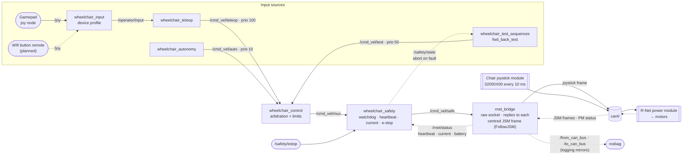

# Wheelchair Command Flow

How a velocity command travels from an input source to the R-Net power module, and how
status from the bus feeds back into safety. Every source passes through the mux and the
safety gate; only `rnet_bridge` writes to the bus. The chair's own joystick module stays on
the bus, and moving it always overrides the bridge (see
[analysis/jsm_handling.md](analysis/jsm_handling.md)).

Operator input arrives in two stages. `wheelchair_input` applies a device profile and
publishes `/operator/input`, which names functions (`deadman`, `estop`, `linear`,
`angular`) rather than axis and button indices, so `wheelchair_teleop` and everything after
it stay the same whatever the controller is. A different gamepad, or a future wifi button
remote, needs a new profile and no code change (requirement 2.1.2).

Solid arrows are the command path to the motors. Dashed arrows are status and fault feedback.

## Topics and services

| Name | Type | From → To |
|---|---|---|
| `/joy` | `sensor_msgs/Joy` | joy node → operator input |
| `/operator/input` | `wheelchair_msgs/OperatorInput` | operator input → teleop |
| `/cmd_vel/teleop` | `geometry_msgs/Twist` | teleop → mux |
| `/cmd_vel/test` | `geometry_msgs/Twist` | test sequence → mux |
| `/cmd_vel/mux` | `geometry_msgs/Twist` | mux → safety |
| `/cmd_vel/safe` | `geometry_msgs/Twist` | safety → bridge |
| `/to_can_bus` | `can_msgs/Frame` | bridge → rosbag (mirror of frames sent) |
| `/from_can_bus` | `can_msgs/Frame` | bridge → rosbag (mirror of frames received) |
| `/rnet/status` | `wheelchair_msgs/RnetStatus` | bridge → safety |
| `/safety/state` | `wheelchair_msgs/SafetyState` | safety → test sequence |
| `/safety/estop` | `std_msgs/Bool` | teleop e-stop button → safety |
| `/mode/request` | `wheelchair_msgs/RequestMode` (service) | teleop → mode manager |
| `/test/start` | `std_srvs/Trigger` (service) | operator → test sequence |
| `/safety/reset` | `std_srvs/Trigger` (service) | operator → safety |

## Faults that stop the motors

| Fault | Detected by | Trigger |
|---|---|---|
| Stale command | safety | no `/cmd_vel/mux` for 200 ms |
| PM heartbeat lost | safety | no `0C140X00` frame for ~2.5 s |
| Over-current | safety | `14300X00` motor current above the set limit |
| E-stop | safety | `/safety/estop` true |
| Bridge input stale | rnet_bridge | no `/cmd_vel/safe` for 100 ms → stops replying; JSM's 0/0 applies |
| Operator override | rnet_bridge | chair's joystick deflected → stops replying until centred for 0.5 s |
| Bridge or computer down | JSM | bridge sends nothing; JSM's centred frames stop the chair |
| Controller unplugged | teleop | no `/operator/input` for 500 ms → teleop falls silent, then 5.2 applies |

Safety faults latch until `/safety/reset` is called. The test sequence aborts as soon as
`/safety/state` reports a fault.

What each control on the handheld does, and the gates that must be open before the
chair will move, are in [controls.md](controls.md).
