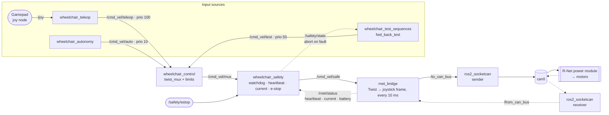

# Wheelchair Command Flow

How a velocity command travels from an input source to the R-Net power module, and how
status from the bus feeds back into safety. Every source passes through the mux and the
safety gate; only `rnet_bridge` writes to the bus.

Solid arrows are the command path to the motors. Dashed arrows are status and fault feedback.

## Topics and services

| Name | Type | From → To |
|---|---|---|
| `/cmd_vel/test` | `geometry_msgs/Twist` | test sequence → mux |
| `/cmd_vel/mux` | `geometry_msgs/Twist` | mux → safety |
| `/cmd_vel/safe` | `geometry_msgs/Twist` | safety → bridge |
| `/to_can_bus` | `can_msgs/Frame` | bridge → socketcan |
| `/from_can_bus` | `can_msgs/Frame` | socketcan → bridge |
| `/rnet/status` | `wheelchair_msgs/RnetStatus` | bridge → safety |
| `/safety/state` | `wheelchair_msgs/SafetyState` | safety → test sequence |
| `/safety/estop` | `std_msgs/Bool` | e-stop → safety |
| `/test/start` | `std_srvs/Trigger` (service) | operator → test sequence |
| `/safety/reset` | `std_srvs/Trigger` (service) | operator → safety |

## Faults that stop the motors

| Fault | Detected by | Trigger |
|---|---|---|
| Stale command | safety | no `/cmd_vel/mux` for 200 ms |
| PM heartbeat lost | safety | no `0C140X00` frame for ~2.5 s |
| Over-current | safety | `14300X00` motor current above the set limit |
| E-stop | safety | `/safety/estop` true |
| Bridge input stale | rnet_bridge | no `/cmd_vel/safe` for 100 ms → sends 0/0 |

Safety faults latch until `/safety/reset` is called. The test sequence aborts as soon as
`/safety/state` reports a fault.
