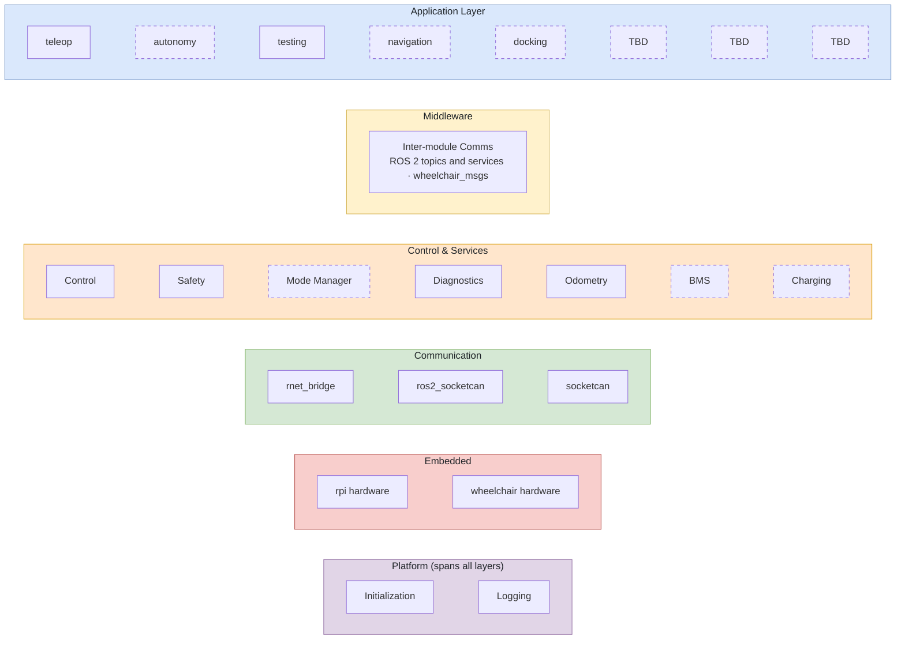

# Wheelchair Layer Stack

Software layers of the R-Net wheelchair tractor, from the apps that decide how to move down
to the hardware that moves the motors. The Platform section starts and records every layer.

Solid boxes are in progress. Dashed boxes are planned.

## Modules by layer

| Layer | Module | Status | Role |
|---|---|---|---|
| Application | teleop | In progress | Gamepad → velocity, deadman button |
| Application | autonomy | Planned | Automatic behaviors |
| Application | testing | In progress | Scripted forward/back test, aborts on fault |
| Application | navigation | Planned | Nav2, coverage paths |
| Application | docking | Planned | Return to charger |
| Middleware | Inter-module Comms | In progress | ROS 2 topics and services, `wheelchair_msgs` |
| Control & Services | Control | In progress | twist_mux arbitration, speed/accel limits |
| Control & Services | Safety | In progress | Watchdog, PM heartbeat, over-current, e-stop |
| Control & Services | Mode Manager | Planned | Idle · Manual · Test · Auto · Fault · E-stop |
| Control & Services | Diagnostics | In progress | Bus health, node status |
| Control & Services | Odometry | In progress | Speed, distance, heading (needs encoders) |
| Control & Services | BMS | Planned | Battery % from PM, low-battery limits |
| Control & Services | Charging | Planned | Charge state and control |
| Communication | rnet_bridge | In progress | Twist → joystick frame `02000X00`, decode PM status |
| Communication | ros2_socketcan | In progress | `/to_can_bus`, `/from_can_bus` |
| Communication | socketcan | In progress | Kernel CAN driver, `can0` @ 125 kbps |
| Embedded | rpi hardware | In progress | Raspberry Pi 3, CAN transceiver |
| Embedded | wheelchair hardware | In progress | R-Net power module, motors, batteries |
| Platform | Initialization | In progress | systemd boot order, `can0` up, launch files, per-machine params |
| Platform | Logging | In progress | rosbag recording, node logs and faults, log rotation |

See [data-flow.md](data-flow.md) for how commands move between these modules.
